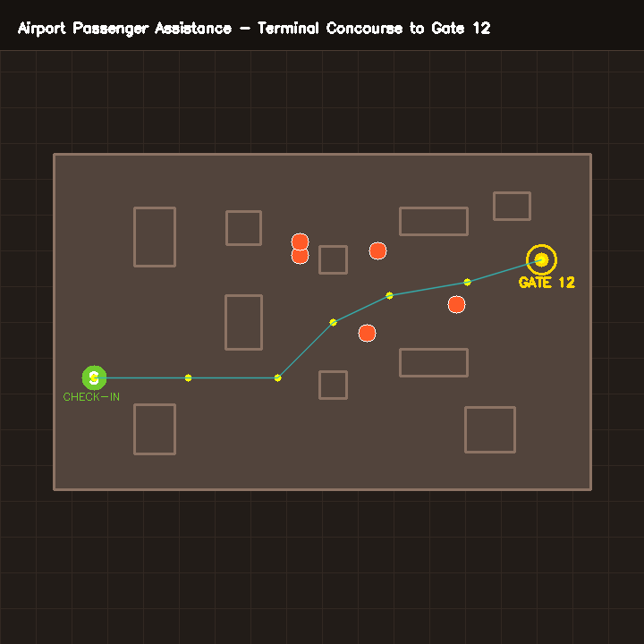

# Task 3: Airport Passenger Assistance Scenario

## Scenario Narrative & Overview
An autonomous airport assistance robot guides an elderly passenger carrying heavy luggage from the terminal check-in hall entrance to boarding Gate 12. The robot must traverse a realistic 24m x 15m terminal hall featuring check-in counter islands, information kiosks, security inspection lanes, structural columns, lounge seating banks, duty-free retail, and boarding podiums. Along the concourse, the robot encounters heterogeneous dynamic human traffic including slow travelers pushing bulky luggage trolleys ($r=0.45\,\text{m}, v=0.40\,\text{m/s}$), hurried business travelers rushing to gates ($r=0.30\,\text{m}, v=0.95\,\text{m/s}$), a coordinated family group walking together ($v=0.55\,\text{m/s}$), and airport staff crossing the concourse ($v=0.60\,\text{m/s}$). On MEDIUM and HARD levels, a dynamic "Boarding Call" event redirects concourse travelers toward Gate 12, creating dynamic multi-agent interaction along the primary concourse aisle.

## Architectural Changes & Specifications

| Dimension | Hotel Room Service (`hotelroomservice`) | Airport Passenger Assistance (`airportpassengerassistance`) |
| :--- | :--- | :--- |
| **Story Context** | Room service tray delivery in a hotel corridor | Luggage assistance robot guiding passenger to Gate 12 |
| **World Bounds** | $[-12.0, 12.0] \times [-8.0, 8.0]\,\text{m}$ ($24\times 16\,\text{m}$) | $[-12.0, 12.0] \times [-7.5, 7.5]\,\text{m}$ ($24\times 15\,\text{m}$) |
| **Robot Start** | $(-10.0, 0.0, 0.0\,\text{rad})$ (Lobby / Service Kitchen) | $(-10.2, -2.5, 0.0\,\text{rad})$ (Terminal Check-in Entrance) |
| **Robot Goal** | $(10.0, 0.0)$ (Guest Suite 104) | $(9.8, 2.8)$ (Gate 12 Boarding Podium) |
| **Separation Dist** | $20.0\,\text{m}$ | $20.69\,\text{m}$ (Diagonal cross-concourse trajectory) |
| **Wall Topology** | Double outer wall (perimeter poly + border offset) | Double outer wall (perimeter poly + border offset) |
| **Obstacle Layout** | 6 rectangular guest room blocks along corridor | 10 rectangular islands: check-in desks, kiosk, security lanes, columns, seating, duty-free |
| **Dynamic Humans** | 4 base agents (hotel guests, trolley staff) | 5 base agents: luggage trolley, hurried traveler, family parent/child, staff + crowd |
| **Special Event** | None | Dynamic "Boarding Call" at step $T=75$ (MEDIUM) and $T=50$ (HARD) heading to Gate 12 |
| **Difficulty Ladder**| EASY (4), MEDIUM (7), HARD (11) | EASY (5 humans, 420 steps), MEDIUM (8 humans, 360 steps), HARD (12 humans, 290 steps) |
| **Navigation Policy**| `HotelNavigationController` ("HOTEL NAVIGATION") | `AirportNavigationController` ("AIRPORT NAVIGATION") |

> [!NOTE]
> **Policy Architecture**: Consistent with the hotel room service scenario reference implementation, `"POLICY: AIRPORT NAVIGATION"` in the video HUD telemetry refers to `AirportNavigationController` in `navrep_custom/airport_passenger_assistance.py`. It implements reactive waypoint tracking, dynamic Time-to-Closest-Approach (TCA) collision avoidance against pedestrians, lateral detour maneuvering if blocked, and terminal docking deceleration at Gate 12.

## Map Layout Preview



- **Green S Circle**: Check-in Entrance start position $(-10.2, -2.5)$ with $\ge 1.80\,\text{m}$ clearance to outer walls and $\ge 2.16\,\text{m}$ clearance to obstacles.
- **Gold Goal Ring**: Gate 12 boarding podium $(9.8, 2.8)$ with $\ge 1.87\,\text{m}$ clearance to obstacles.
- **Yellow Waypoint Path**: Collision-free concourse passage through check-in aisles, central concourse junction, and lounge corridors.
- **Coral Human Circles**: Dynamic human agents with velocity orientation arrows.

## Empirical Benchmark Results (20 Episodes per Level, Seeds 100–119)

Each level was evaluated across 20 fixed benchmark episodes (seeds 100–119) using `AirportNavRepEnv` and `AirportNavigationController`. Metrics strictly sum to $100\%$ across outcomes:

| Difficulty Level | Dynamic Humans | Time Limit (Steps / s) | Success Rate (%) | Collision Rate (%) | Timeout Rate (%) | Mean Time-to-Goal (s) |
| :---: | :---: | :---: | :---: | :---: | :---: | :---: |
| **EASY** | 5 | 420 steps ($84.0\,\text{s}$) | **100.0%** (20/20) | 0.0% (0/20) | 0.0% (0/20) | 32.76 s |
| **MEDIUM** | 8 | 360 steps ($72.0\,\text{s}$) | **50.0%** (10/20) | 20.0% (4/20) | 30.0% (6/20) | 33.46 s |
| **HARD** | 12 | 290 steps ($58.0\,\text{s}$) | **15.0%** (3/20) | 50.0% (10/20) | 35.0% (7/20) | 32.87 s |

### Seed Calibration (Medium Search, Seeds 0–59)
- **Evaluated**: 60 episodes at MEDIUM difficulty.
- **Goal Reached Successes**: 35 / 60 (58.3%) — e.g. seeds `0`, `1`, `3`, `4`, `7`, `42`.
- **Collisions**: 9 / 60 (15.0%) — e.g. seeds `5`, `13`, `20`, `27`, `38`.
- **Timeouts**: 16 / 60 (26.7%) — e.g. seeds `2`, `6`, `8`, `11`, `14`.

## Demonstration Videos

All videos are rendered at $640\times 640$, 12 fps, H.264 `yuv420p` with top-down static camera, cyan path trail, real-time distance-to-goal tracking, and verified quality gates:

| File | Level | Seed | Outcome | Steps | Final Dist | Duration | Frozen Frames | Quality Gate |
| :--- | :---: | :---: | :---: | :---: | :---: | :---: | :---: | :---: |
| [`airport_passenger_assistance_easy_success.mp4`](videos/airport_passenger_assistance_easy_success.mp4) | EASY | 100 | GOAL_REACHED | 164 | 0.35 m | 14.50 s | 10 | **PASS** |
| [`airport_passenger_assistance_medium_success.mp4`](videos/airport_passenger_assistance_medium_success.mp4) | MEDIUM | 0 | GOAL_REACHED | 163 | 0.41 m | 14.42 s | 10 | **PASS** |
| [`airport_passenger_assistance_medium_failure.mp4`](videos/airport_passenger_assistance_medium_failure.mp4) | MEDIUM | 118 | COLLISION | 287 | 6.61 m | 24.75 s | 10 | **PASS** |
| [`airport_passenger_assistance_hard_bestprogress.mp4`](videos/airport_passenger_assistance_hard_bestprogress.mp4) | HARD | 111 | TIMEOUT | 290 | 1.30 m | 25.00 s | 10 | **PASS** |

## Execution & Reproduction Commands

### 1. Run Scenario Unit Tests
```bash
python -m unittest tests/test_airport_scenario.py
```

### 2. Run Calibration & 20-Episode Benchmark
```bash
python scripts_custom/benchmark_airport.py
```

### 3. Record All 4 Demonstration Videos
```bash
python scripts_custom/record_airport_demo.py
```

### 4. Verify Video Quality Gates Only
```bash
python scripts_custom/record_airport_demo.py --verify-only
```
