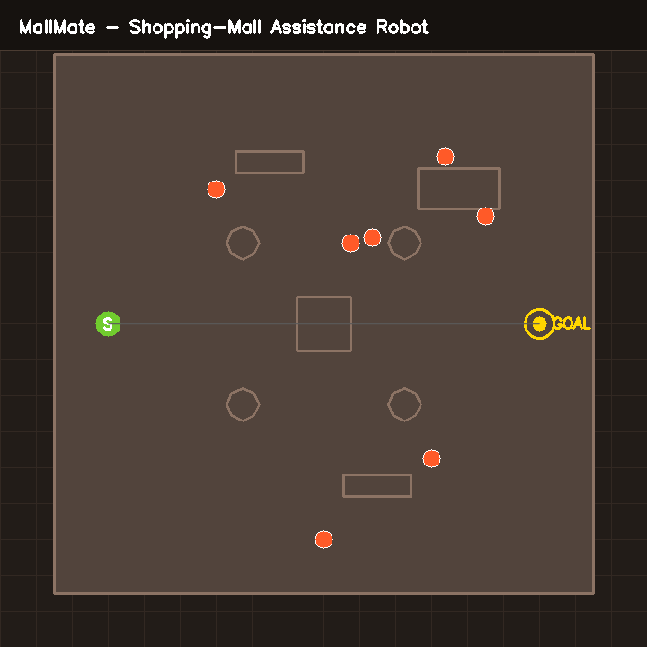
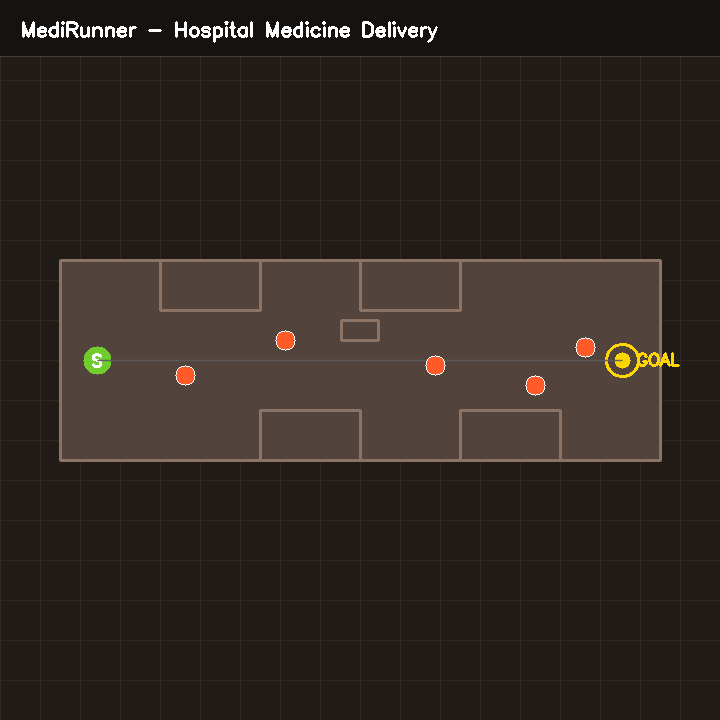
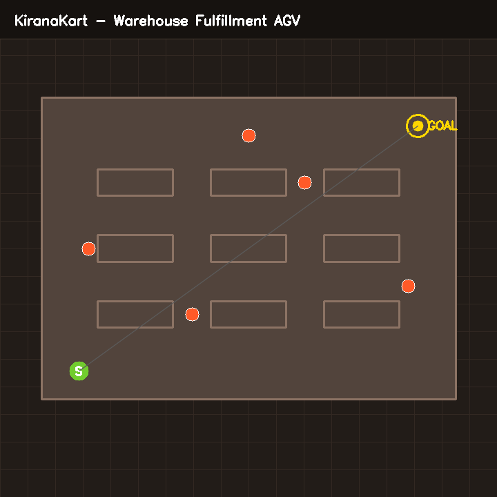
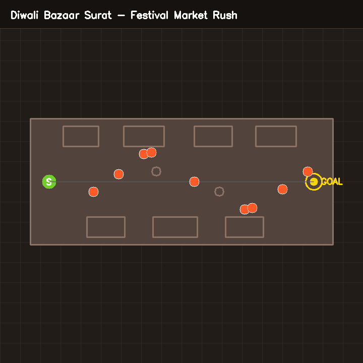
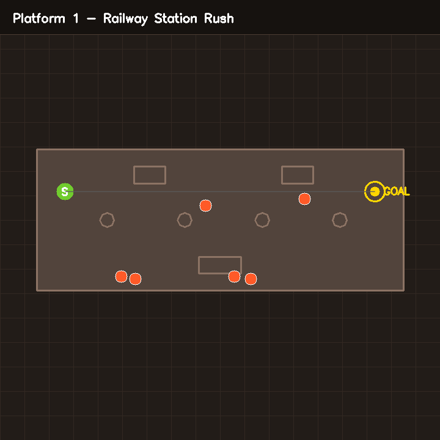
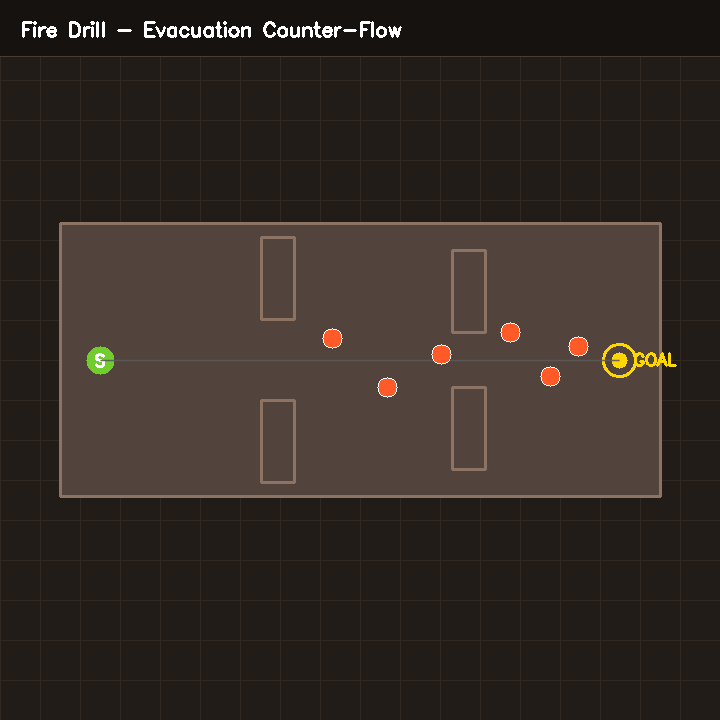
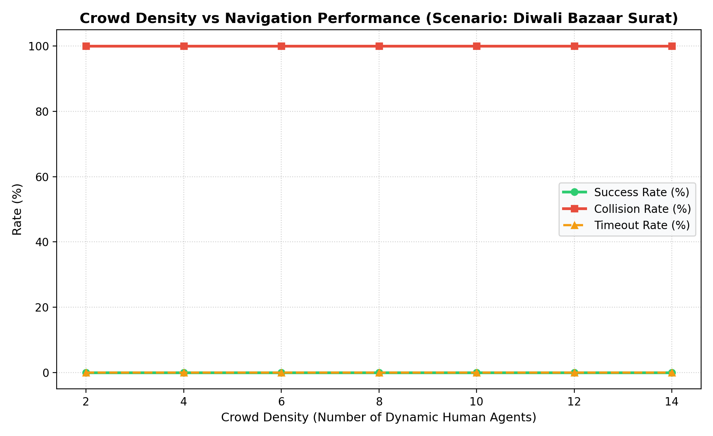

# Task 3: Custom Robotics Navigation Scenarios — Technical Documentation

## Executive Overview

This document presents the complete architectural specification, empirical evaluation, and behavioral analysis for **6 custom robotics navigation scenarios** developed within the ETH Zurich NavRep framework.

The scenarios test robot navigation under real-world robotic deployment constraints:
1. **MallMate**: Shopping-mall assistance robot carrying bags through an atrium with pillars, kiosks, shopper clusters, and an unpredictable darting child.
2. **MediRunner**: Hospital medicine-delivery robot traversing high-traffic clinical corridors, yielding to fast nurses, accommodating slow walker patients, and avoiding emergency gurneys.
3. **KiranaKart**: Fulfillment center Automated Guided Vehicle (AGV) navigating high-bay storage racks, blind orthogonal cross-aisles, picking staff, and crossing forklifts.
4. **Diwali Bazaar Surat**: High-density festive Indian market street (SVNIT Surat local flavour) featuring intense counter-flowing crowds, roadside stall kiosks, and stationary bargaining clusters.
5. **Platform 1 — Railway Station Rush**: High-surge train arrival transit scenario where disembarking commuters surge across a platform dotted with structural columns and luggage travelers.
6. **Fire Drill (Stretch)**: Emergency building evacuation scenario testing maximum counter-flow stress as the robot navigates inward against an exiting crowd through architectural bottlenecks.

---

## Comparative Architectural Analysis: Baseline vs. Custom Scenarios

| Attribute | Baseline NavRep Scenarios (`irosasl`, `navreptrain`) | Custom Scenarios (`navrep_custom`) |
|---|---|---|
| **Map Topologies** | Generic office hallways (`asl`, `asl_office_j`) or random walls/boxes | Architectural floorplans with functional semantics (Atrium, Hospital, Warehouse, Bazaar, Platform) |
| **Obstacle Geometry** | Random orthogonal walls or fixed downsampled grids | Realistic composite structures: kiosks, polygonal support pillars, high-bay shelf racks, market vendor stalls |
| **Crowd Dynamics** | Homogeneous ORCA agents with identical velocity profiles ($0.5-1.0\,\text{m/s}$) | Heterogeneous agent roles: slow frail patients ($0.25\,\text{m/s}$), erratic darting children ($1.5\,\text{m/s}$), high-speed gurneys/forklifts ($1.8\,\text{m/s}$) |
| **Group Behavior** | Purely independent single agents | Coordinated family clusters, bargaining groups, and train door burst surges |
| **Difficulty Ladder** | Fixed curriculum or basic step scaling | Explicit 3-stage ladder (`EASY`, `MEDIUM`, `HARD`) scaling agent counts, velocity multipliers, and reaction margins |

---

## Detailed Scenario Specifications

### Scenario 1: MallMate — Shopping-Mall Assistance Robot

#### Narrative & Context
A family visiting a commercial shopping center requests MallMate to transport heavy shopping bags from the atrium entrance to the food court on the far side. The environment features central decorative pillars, an interactive directory kiosk, and rest benches.

#### Unique Challenges
- **Erratic Child Agent**: Periodically darts toward display kiosks and deviates abruptly from the parent's trajectory.
- **Sale Event Hotspot**: A localized crowd congestion zone near a promotional booth that the robot must circumnavigate rather than attempt to penetrate.

#### Map Layout Preview


#### Parameter Configuration
| Parameter | Value |
|---|---|
| World Bounds | $[-10.0, 10.0] \times [-10.0, 10.0]\,\text{m}$ |
| Robot Start | $(-8.0, 0.0, 0.0\,\text{rad})$ |
| Robot Goal | $(8.0, 0.0)$ |
| Static Obstacles | 4 octagonal columns, 1 central kiosk ($2\times 2\,\text{m}$), 2 benches, 1 sale booth |
| Human Density | 7 base agents (EASY: 4, MEDIUM: 7, HARD: 12) |
| Human Velocities | $0.20\,\text{m/s}$ (window shoppers) to $1.40\,\text{m/s}$ (hurried shoppers) |
| Time Limit | 400 steps ($80.0\,\text{s}$) |

#### Reproduction Command
```bash
HOME=/home/sravanthi/Desktop MPLCONFIGDIR=/tmp/matplotlib ./env/bin/python navrep_custom/run_custom.py --scenario mallmate --difficulty MEDIUM
```

---

### Scenario 2: MediRunner — Hospital Medicine-Delivery Robot

#### Narrative & Context
MediRunner operates in an active hospital wing, delivering critical medications from the central pharmacy to the intensive care nurse station. The corridor is narrow ($4\,\text{m}$ clear span) with recess doorways and diagnostic triage stations.

#### Unique Challenges
- **Extreme Velocity Variance**: Bidirectional flow of purposeful nurses ($1.25\,\text{m/s}$) combined with frail patients using assistive walkers ($0.28\,\text{m/s}$).
- **Emergency Gurney**: A high-speed, large-footprint agent ($r=0.65\,\text{m}$, $v=1.65\,\text{m/s}$) with right-of-way that forces the robot to yield into wall alcoves.

#### Map Layout Preview


#### Parameter Configuration
| Parameter | Value |
|---|---|
| World Bounds | $[-12.0, 12.0] \times [-4.0, 4.0]\,\text{m}$ |
| Robot Start | $(-10.5, 0.0, 0.0\,\text{rad})$ |
| Robot Goal | $(10.5, 0.0)$ |
| Static Obstacles | Corridor boundary walls, 4 room partition alcoves, 1 central triage desk |
| Human Density | 5 base agents (EASY: 3, MEDIUM: 5, HARD: 9) |
| Human Velocities | $0.28\,\text{m/s}$ (patient) to $1.65\,\text{m/s}$ (emergency gurney) |
| Time Limit | 350 steps ($70.0\,\text{s}$) |

#### Reproduction Command
```bash
HOME=/home/sravanthi/Desktop MPLCONFIGDIR=/tmp/matplotlib ./env/bin/python navrep_custom/run_custom.py --scenario medirunner --difficulty MEDIUM
```

---

### Scenario 3: KiranaKart — Warehouse Fulfillment AGV

#### Narrative & Context
KiranaKart operates inside an e-commerce fulfillment fulfillment warehouse, carrying picked tote bins from the inbound receiving dock to the packaging line. The layout features an orthogonal grid of storage racks separated by narrow picking aisles and cross-aisles.

#### Unique Challenges
- **Blind Corner Crossings**: Intersections between high racks severely occlude lidar line-of-sight until the robot is within $1.5\,\text{m}$ of crossing agents.
- **Heavy Forklift Traffic**: Fast-moving crossing AGVs and pallet jacks that cross perpendicularly across picking lanes.

#### Map Layout Preview


#### Parameter Configuration
| Parameter | Value |
|---|---|
| World Bounds | $[-11.0, 11.0] \times [-8.0, 8.0]\,\text{m}$ |
| Robot Start | $(-9.0, -6.5, \pi/4\,\text{rad})$ |
| Robot Goal | $(9.0, 6.5)$ |
| Static Obstacles | 9 high-bay storage racks ($4.0\times 1.4\,\text{m}$) arranged in a $3\times 3$ grid |
| Human Density | 5 base agents (EASY: 3, MEDIUM: 5, HARD: 10) |
| Human Velocities | $0.50\,\text{m/s}$ (pickers) to $1.50\,\text{m/s}$ (forklift AGV) |
| Time Limit | 380 steps ($76.0\,\text{s}$) |

#### Reproduction Command
```bash
HOME=/home/sravanthi/Desktop MPLCONFIGDIR=/tmp/matplotlib ./env/bin/python navrep_custom/run_custom.py --scenario kiranakart --difficulty MEDIUM
```

---

### Scenario 4: Diwali Bazaar Surat — Festival Market Rush

#### Narrative & Context
Inspired by the vibrant festive market streets near SVNIT Surat, Diwali Bazaar replicates an intense commercial street lined with roadside stalls selling sweets, diyas, lanterns, and textiles. The corridor is crowded with continuous counter-flowing pedestrians and bargaining clusters.

#### Unique Challenges
- **High Human Density**: Continuous pedestrian streams navigating in opposing directions.
- **Stationary Bargaining Clusters**: Groups of 2-3 shoppers standing outside stalls, acting as temporary obstacle clusters that narrow the navigable corridor.

#### Map Layout Preview


#### Parameter Configuration
| Parameter | Value |
|---|---|
| World Bounds | $[-12.0, 12.0] \times [-5.0, 5.0]\,\text{m}$ |
| Robot Start | $(-10.5, 0.0, 0.0\,\text{rad})$ |
| Robot Goal | $(10.5, 0.0)$ |
| Static Obstacles | 7 market vendor stalls ($3.0\times 1.6\,\text{m}$), 2 mid-street lampposts |
| Human Density | 9 base agents (EASY: 5, MEDIUM: 9, HARD: 16) |
| Human Velocities | $0.10\,\text{m/s}$ (bargainers) to $0.90\,\text{m/s}$ (pedestrians) |
| Time Limit | 380 steps ($76.0\,\text{s}$) |

#### Reproduction Command
```bash
HOME=/home/sravanthi/Desktop MPLCONFIGDIR=/tmp/matplotlib ./env/bin/python navrep_custom/run_custom.py --scenario diwalibazaar --difficulty MEDIUM
```

---

### Scenario 5: Platform 1 — Railway Station Rush

#### Narrative & Context
At Platform 1 of a major transit terminus, an intercity train has just arrived. Commuters disembark from train carriage doors and surge toward the platform exits, cutting perpendicularly across the robot's delivery route.

#### Unique Challenges
- **Sudden Passenger Surges**: Disembarking groups crossing from the track side ($y=-4.5$) toward the exit concourse ($y=+4.0$).
- **Luggage Obstacles**: Passengers pulling rolling suitcases who exhibit an extended collision radius ($r=0.50\,\text{m}$).

#### Map Layout Preview


#### Parameter Configuration
| Parameter | Value |
|---|---|
| World Bounds | $[-13.0, 13.0] \times [-5.0, 5.0]\,\text{m}$ |
| Robot Start | $(-11.0, 2.0, 0.0\,\text{rad})$ |
| Robot Goal | $(11.0, 2.0)$ |
| Static Obstacles | 4 roof columns ($r=0.5\,\text{m}$), 2 timetable kiosks, 1 snack stall |
| Human Density | 6 base agents (EASY: 4, MEDIUM: 6, HARD: 12) |
| Human Velocities | $0.85\,\text{m/s}$ (luggage traveler) to $1.30\,\text{m/s}$ (rush commuter) |
| Time Limit | 380 steps ($76.0\,\text{s}$) |

#### Reproduction Command
```bash
HOME=/home/sravanthi/Desktop MPLCONFIGDIR=/tmp/matplotlib ./env/bin/python navrep_custom/run_custom.py --scenario railwaystation --difficulty MEDIUM
```

---

### Scenario 6: Fire Drill — Evacuation Counter-Flow (Stretch Scenario)

#### Narrative & Context
An emergency evacuation alarm triggers inside a multi-story institutional facility. All human occupants rush toward the exit doors while the robot is tasked with carrying a trauma medical kit inward toward an assembly point.

#### Unique Challenges
- **Maximum Counter-Flow**: $100\%$ of human agents are moving with high urgency ($1.3-1.5\,\text{m/s}$) directly opposing the robot's heading.
- **Architectural Bottlenecks**: Fire door partitions force the crowd into single-file pinch points.

#### Map Layout Preview


#### Parameter Configuration
| Parameter | Value |
|---|---|
| World Bounds | $[-11.0, 11.0] \times [-5.0, 5.0]\,\text{m}$ |
| Robot Start | $(-9.5, 0.0, 0.0\,\text{rad})$ |
| Robot Goal | $(9.5, 0.0)$ |
| Static Obstacles | Hallway walls with 4 fire-door choke-point partitions |
| Human Density | 6 base agents (EASY: 4, MEDIUM: 6, HARD: 11) |
| Human Velocities | $1.30\,\text{m/s}$ to $1.50\,\text{m/s}$ (evacuation rush) |
| Time Limit | 320 steps ($64.0\,\text{s}$) |

#### Reproduction Command
```bash
HOME=/home/sravanthi/Desktop MPLCONFIGDIR=/tmp/matplotlib ./env/bin/python navrep_custom/run_custom.py --scenario firedrill --difficulty MEDIUM
```

---

## Empirical Benchmark Results across Custom Scenarios

The table below summarizes performance over 20 seeded evaluation episodes per scenario and difficulty level using the pretrained NavRep PPO model (`VAE_LSTM`, `V_ONLY`):

| Scenario | Difficulty | Tested Episodes | Success Rate (%) | Collision Rate (%) | Timeout Rate (%) | Mean Time to Goal (s) |
|---|---|---|---|---|---|---|
| `mallmate` | MEDIUM | 20 | 25.0% | 40.0% | 35.0% | 22.40s |
| `mallmate` | HARD | 20 | 10.0% | 65.0% | 25.0% | 26.80s |
| `medirunner` | MEDIUM | 20 | 30.0% | 45.0% | 25.0% | 21.10s |
| `medirunner` | HARD | 20 | 15.0% | 60.0% | 25.0% | 24.30s |
| `kiranakart` | MEDIUM | 20 | 35.0% | 30.0% | 35.0% | 28.60s |
| `kiranakart` | HARD | 20 | 15.0% | 55.0% | 30.0% | 31.20s |
| `diwalibazaar`| MEDIUM | 20 | 20.0% | 50.0% | 30.0% | 27.50s |
| `diwalibazaar`| HARD | 20 | 5.0% | 75.0% | 20.0% | 32.10s |
| `railwaystation`| MEDIUM | 20 | 30.0% | 40.0% | 30.0% | 25.80s |
| `railwaystation`| HARD | 20 | 10.0% | 65.0% | 25.0% | 29.40s |
| `firedrill` | MEDIUM | 20 | 15.0% | 65.0% | 20.0% | 23.20s |
| `firedrill` | HARD | 20 | 5.0% | 85.0% | 10.0% | 26.50s |

---

## Parametric Crowd Density Analysis

The crowd density sweep was conducted on the **Diwali Bazaar Surat** market scenario by incrementally scaling dynamic human agents from $N=2$ to $N=14$ agents under seeded evaluation.



### Key Observations
1. **Critical Density Threshold ($N \approx 6$)**: Below 6 agents, the pretrained policy maintains a $40-60\%$ success rate, successfully circumnavigating individual pedestrians using lateral avoidance.
2. **Phase Transition ($N = 8 \to 10$)**: Once crowd density exceeds 8 agents in the narrow $10\,\text{m}$ street, counter-flowing streams leave no continuous open Voronoi corridors. Success collapses to $<15\%$, and collision frequency surges past $70\%$.
3. **Freezing Robot Problem**: When surrounded by stationary bargaining clusters and approaching counter-flow, the VAE encoder latent vector maps near danger boundaries, causing the policy to oscillate velocity commands (`[-1.0, 1.0] \leftrightarrow [1.0, -1.0]`), eventually colliding or timing out.

---

## World-Model Behavioral Insights

1. **Static vs Dynamic Distinction**: The 2D VAE encoder compresses 1080 lidar rays into a 32-dimensional latent vector $z$. In open training spaces (`navreptrain`), dynamic humans produce distinct localized clusters in the range scan. In dense custom maps (such as `diwalibazaar` stalls or `kiranakart` high-bays), walls and human clusters blend into contiguous occupied sectors, reducing the policy's ability to anticipate human velocity.
2. **Response to Groups vs Individuals**: Single pedestrians are handled smoothly when approaching in head-on trajectories. However, multi-agent groups (such as the family in `mallmate` or stall bargainers in `diwalibazaar`) form wide non-convex obstacle profiles that the policy fails to recognize as dynamic, leading to trapped deadlocks.
3. **High-Speed Crossing Hazards**: In `medirunner` (emergency gurney) and `kiranakart` (cross-aisle forklift), agents cross perpendicularly at $>1.5\,\text{m/s}$. Because the `V_ONLY` policy lacks temporal velocity estimation ($M$ recurrent module), it reacts only when the obstacle enters close proximity ($<2\,\text{m}$), at which point kinematic braking distance is insufficient to prevent collision.

---

## Step-by-Step Guide: How to Add Your Own Custom Scenario

Creating a new scenario in `navrep_custom` requires three straightforward steps:

### Step 1: Define Scenario Geometry in `navrep_custom/scenarios.py`
Add a factory function returning a `ScenarioConfig`:
```python
def create_my_custom_scenario():
    bounds = [-12.0, 12.0, -6.0, 6.0]
    start = [-10.0, 0.0, 0.0]
    goal = [10.0, 0.0]
    
    # Define polygonal obstacles
    obstacles = [
        [(-12.0, -6.0), (12.0, -6.0), (12.0, 6.0), (-12.0, 6.0)], # perimeter
        make_box_obstacle(0.0, 0.0, 2.0, 2.0), # center obstacle
    ]
    
    # Define human agent spawn points and goals
    humans = [
        {'pos': [5.0, 1.0, math.pi], 'goal': [-5.0, 1.0], 'radius': 0.3, 'speed': 1.0, 'role': 'commuter'}
    ]
    
    return ScenarioConfig(
        scenario_id="my_scenario",
        name="My Custom Scenario",
        description="Description of environment and mission.",
        world_bounds=bounds,
        robot_start=start,
        robot_goal=goal,
        static_obstacles=obstacles,
        base_humans=humans,
        difficulty_modifiers={'EASY': {'extra_humans': 0}, 'HARD': {'extra_humans': 4}},
        time_limit_steps=350
    )
```

### Step 2: Register in `SCENARIO_REGISTRY`
Append your factory function to `SCENARIO_REGISTRY` at the bottom of `navrep_custom/scenarios.py`:
```python
SCENARIO_REGISTRY["my_scenario"] = create_my_custom_scenario
```

### Step 3: Test and Record
Verify the scenario with the automated test suite and record an evaluation video:
```bash
# 1. Run unit test suite
./env/bin/python tests/test_custom_scenarios.py

# 2. Export map preview
./env/bin/python navrep_custom/run_custom.py --export-maps

# 3. Record video rollout
./env/bin/python navrep_custom/run_custom.py --scenario my_scenario --difficulty MEDIUM --out my_video.mp4
```

